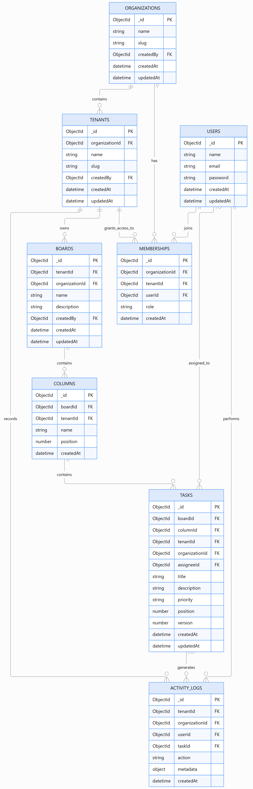

# KanbanFlow – Real-Time Collaborative Kanban Board

A full-stack, real-time collaborative Kanban application built using the MERN stack. KanbanFlow enables multiple users across organizations and workspaces (tenants) to manage tasks, collaborate in real time, and track project activity with tenant-level data isolation.

## 🚀 Live Demo

**Live Application:** https://collaborative-kanban-blue.vercel.app/

**GitHub Repository:** https://github.com/Sameermd25/collaborative-kanban

---

## 📌 Project Overview

KanbanFlow is designed to simplify team collaboration through an interactive Kanban board.

The application follows a multi-organization and multi-tenant architecture, allowing organizations to create multiple workspaces and manage their boards, members, and tasks independently.

Users can create boards, organize tasks into columns, assign tasks to team members, and see updates in real time without refreshing the application.

## ✨ Features

### 1. Authentication & Authorization
- User registration and login.
- JWT-based authentication.
- Protected routes and authenticated API access.
- Role-based access control for organization admins, tenant admins, and members.

### 2. Multi-Organization & Multi-Tenant Architecture
- Create and manage multiple organizations.
- Create multiple workspaces (tenants) under an organization.
- Switch between organizations and workspaces.
- Maintain tenant-scoped business data.
- Prevent unauthorized cross-tenant access.

### 3. Kanban Board Management
- Create and manage multiple boards.
- Organize boards using customizable columns.
- Create, update, and delete tasks.
- Move tasks between columns using drag-and-drop.
- Assign tasks to workspace members.
- Set task priorities and descriptions.

### 4. Real-Time Collaboration
- Real-time task synchronization using Socket.IO.
- Tenant-scoped communication rooms.
- Live updates when tasks are created, modified, deleted, or moved.
- Online presence indicators for workspace members.

### 5. Task Management
- View task details in a dedicated detail panel.
- Assign tasks to members.
- Track task priority and status.
- Maintain task ordering within columns.

### 6. Concurrency & Conflict Handling
- Task versioning to track modifications.
- Version-based optimistic concurrency checks on the backend.
- Prevent stale updates from silently overwriting newer task changes.

### 7. Activity Tracking
- Record task-related activities.
- Track task creation, updates, movements, and deletions.
- Display recent workspace activity.

### 8. Additional Features
- Optimistic UI updates.
- Undo and redo support for implemented task operations.
- Workspace switching.
- Theme customization.
- Responsive user interface.

---

## 🛠️ Tech Stack

| Category | Technologies |
|---|---|
| Frontend | React.js, Vite |
| State Management | Redux Toolkit |
| Styling | CSS |
| Backend | Node.js, Express.js |
| Database | MongoDB, Mongoose |
| Authentication | JSON Web Tokens (JWT) |
| Real-Time Communication | Socket.IO |
| API Testing | Postman |
| Version Control | Git, GitHub |
| Frontend Deployment | Vercel |
| Backend Deployment | Render |

---

## 🏗️ System Architecture

KanbanFlow follows a client-server architecture.

```text
             React Frontend
                   |
          Redux Toolkit Store
                   |
             Axios / HTTP
                   |
             Express Server
                   |
        Authentication & RBAC
                   |
          Controllers / Routes
                   |
              MongoDB
                   
        Socket.IO Communication
                   |
          Tenant-Scoped Rooms
                   |
       Real-Time Client Updates
```

### Application Flow

1. Users authenticate through the frontend.
2. The backend verifies JWT authentication.
3. Users access organizations and their associated workspaces based on membership.
4. Boards, columns, and tasks are accessed within the active tenant.
5. Backend authorization and tenant-scoping checks protect business data.
6. Socket.IO broadcasts relevant updates to connected users in the same tenant.

---

## 🗄️ Database Design

The application uses MongoDB with Mongoose models.

The database design consists of the following entities:

| Entity | Responsibility |
|---|---|
| Organizations | Stores organization information |
| Tenants | Represents workspaces or branches |
| Users | Stores user accounts |
| Memberships | Connects users with organizations and tenants through roles |
| Boards | Stores boards belonging to organizations and tenants |
| Columns | Organizes tasks within boards |
| Tasks | Stores task details, assignments, priorities, and versions |
| Activity Logs | Tracks workspace activities |

### Entity Relationship Diagram

The logical database relationships are represented below.



**Hierarchy:**

```text
Organization
    |
    └── Tenants (Workspaces)
            |
            └── Boards
                    |
                    └── Columns
                            |
                            └── Tasks
```

Users access organizations and tenants through memberships.

Tasks and activity logs are associated with tenant and organization identifiers to support scoped access.

---

## 🔐 Multi-Tenancy & Data Isolation

KanbanFlow uses a hierarchical multi-tenant architecture.

**Organization → Tenant → Board → Column → Task**

Key design considerations:

- Every tenant-specific business resource is associated with a tenant.
- Organization and tenant identifiers are used when querying protected resources.
- User membership and role information are used for authorization.
- Socket.IO rooms are scoped to tenants.
- Activity logs are retrieved within the authorized workspace context.

This architecture helps prevent users from accessing data belonging to unauthorized tenants or organizations.

---

## ⚡ Real-Time Communication

Socket.IO is used to synchronize changes between connected users.

The backend uses tenant-scoped rooms so that updates are delivered to users collaborating within the relevant workspace.

Examples of real-time activities include:

- Task creation.
- Task updates.
- Task deletion.
- Task movement.
- Online presence updates.

This allows multiple users to collaborate without manually refreshing the board.

---

## 🔄 Concurrency Handling

KanbanFlow uses task versioning to handle concurrent modifications.

Each task maintains a version number.

When a task is updated:

1. The client sends the task ID and expected version.
2. The backend checks the current version.
3. If the version matches, the update is applied.
4. The version is incremented.
5. If the version is outdated, the backend rejects the conflicting update rather than silently overwriting newer data.

This provides a basic optimistic concurrency control strategy.

---

## 📂 Project Structure

```text
collaborative-kanban/
│
├── backend/
│   ├── src/
│   │   ├── config/
│   │   ├── controllers/
│   │   ├── middleware/
│   │   ├── models/
│   │   ├── routes/
│   │   ├── sockets/
│   │   └── server.js
│   │
│   ├── package.json
│   └── .env.example
│
├── frontend/
│   ├── src/
│   │   ├── app/
│   │   ├── components/
│   │   ├── features/
│   │   ├── pages/
│   │   └── ...
│   │
│   └── package.json
│
├── docs/
│   ├── er-diagram.png
│   ├── API.md
│   └── WEBSOCKET.md
│
├── README.md
└── .gitignore
```

*The structure above is illustrative; retain your actual folder and file names.*

---

## ⚙️ Local Installation & Setup

### Prerequisites

- Node.js
- npm
- MongoDB Atlas account or local MongoDB instance
- Git

### 1. Clone the repository

```bash
git clone https://github.com/Sameermd25/collaborative-kanban.git
cd collaborative-kanban
```

### 2. Install backend dependencies

```bash
cd backend
npm install
```

### 3. Configure backend environment variables

Create a `.env` file inside the `backend` directory.

Configure the variables using the names expected by your backend configuration:

```env
PORT=5000
CLIENT_URL=http://localhost:5173
MONGODB_URI=your_mongodb_connection_string
JWT_SECRET=your_jwt_secret
```

### 4. Start the backend

```bash
npm run dev
```

The backend should run at:

```text
http://localhost:5000
```

### 5. Install frontend dependencies

Open another terminal:

```bash
cd frontend
npm install
```

### 6. Configure frontend environment variables

Create a `.env` file inside the `frontend` directory:

```env
VITE_API_URL=http://localhost:5000
VITE_SOCKET_URL=http://localhost:5000
```

### 7. Start the frontend

```bash
npm run dev
```

The frontend should be available at:

```text
http://localhost:5173
```

---

## 📖 API Documentation

The backend exposes REST APIs for authentication, organizations, tenants, memberships, boards, columns, tasks, and activity logs.

API documentation should include:

- HTTP method and endpoint.
- Authentication requirements.
- Required roles and permissions.
- Request parameters and body.
- Success and error responses.
- Tenant-scoping behavior.

Detailed endpoint documentation: `docs/API.md`.

## 🔌 WebSocket Documentation

Socket.IO provides real-time communication between users collaborating in the same tenant.

The WebSocket documentation should describe:

- Connection and authentication.
- Tenant room joining and leaving.
- Task event names and payloads.
- Presence events.
- Disconnection and reconnection behavior.
- Tenant isolation.

Detailed event documentation: `docs/WEBSOCKET.md`.

---

## 🚀 Deployment

The application is deployed using:

| Component | Platform |
|---|---|
| Frontend | Vercel |
| Backend | Render |
| Database | MongoDB Atlas |

**Live Application:** https://collaborative-kanban-blue.vercel.app/

---

## 🧠 Technical Challenges & Learnings

While developing KanbanFlow, I worked on:

- Designing a multi-organization and multi-tenant data model.
- Implementing tenant-level authorization and data isolation.
- Building real-time synchronization with Socket.IO.
- Managing application state using Redux Toolkit.
- Handling concurrent task modifications through versioning.
- Implementing drag-and-drop task management.
- Maintaining activity history and workspace presence.
- Deploying a full-stack MERN application.

---

## 🔮 Future Improvements

- More comprehensive automated integration and end-to-end tests.
- Advanced conflict-resolution workflows.
- More granular role and permission management.
- Improved offline support and network recovery.
- Pagination and indexing for large workspaces.
- Enhanced real-time collaboration features.

---

## 👨‍💻 Author

**Md Sameer**

- **GitHub:** https://github.com/Sameermd25/
- **LinkedIn:** https://www.linkedin.com/in/md-sameer-626b83299/
- **LeetCode:** https://leetcode.com/u/SameerMd25/

---

⭐ If you find this project interesting, feel free to explore the repository and share your feedback.
